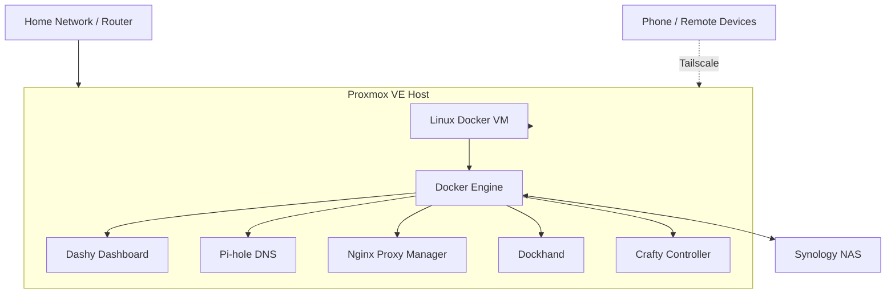

# The Bunker — Homelab

**Virtualization • Self-Hosted Services • Network Security • Remote Access**

  
  
  

I have built my personal homelab to rekindle my passion for IT after graduating with a degree in the field. So far I have aimed to build hands-on experience with IT infrastructure, virtualization, networking, system administration, and cybersecurity. The project combines virtual machines, containerized applications, network-wide DNS filtering, centralized storage, and secure remote access in a self-hosted environment.

The goal is to build practical skills through deploying, configuring, maintaining, and troubleshooting real services while documenting the infrastructure and lessons learned along the way.

## Overview

**Project status: ACTIVE DEVELOPMENT**

The Bunker is a continuously evolving homelab. Services are introduced, configured, tested, and refined as I expand the environment and learn new technologies.

The focus is on understanding how the infrastructure works rather than simply getting applications running. This includes virtual machine management, Docker networking, DNS resolution, reverse proxies, HTTPS certificates, remote connectivity, storage, and troubleshooting.

## Architecture

## Hardware

### Compute

- **Virtualization host:** Secondary Budget OptiPlex PC running Proxmox VE.
    
- **Processor:** Intel Core i5-4590 @ 3.30 GHz.
    
- **Memory:** 32 GB RAM.
    
- **Virtualization:** Linux virtual machines managed through the Proxmox web interface.
    

### Storage

- **NAS:** Synology DS223j.
    
- **Shared storage:** Synology DSM network shares.
    
- **File synchronization:** Syncthing for synchronizing an Obsidian vault between devices.
    
- **Storage goals:** Centralize files and make personal data accessible across computers and mobile devices.
    

## Features

### Virtualization & Infrastructure

-  Proxmox VE virtualization host.
    
-  Linux virtual machine for Docker workloads.
    
-  Web-based management of virtual machines and host resources.
    
-  Remote administration of the virtualization environment.
    
-  Refine VM resource allocation and storage management.
    

### Containerization & Service Management

-  Docker for running self-hosted applications.
    
-  Dockhand for managing Docker containers and stacks through a graphical interface.
    
-  Dashy as a centralized homelab dashboard.
    
-  Nginx Proxy Manager for reverse-proxy and certificate management.
    
-  Pi-hole for DNS-based ad and domain filtering.
    
-  Expand application deployment and document service dependencies.
    
-  Improve container recovery and persistent-volume management.
    

### Networking & Security

-  Private home network with locally hosted services.
    
-  Pi-hole configured as a DNS resolver.
    
-  Tailscale for private remote connectivity.
    
-  DuckDNS for dynamic DNS.
    
-  Let's Encrypt TLS certificates managed through Nginx Proxy Manager.
    
-  HTTPS access to self-hosted applications.
    
-  Refine remote-access policies and service exposure.
    
-  Document firewall rules, DNS resolution, and network traffic flows.
    
-  Develop a repeatable security-hardening checklist.
    

### Storage & Personal Services

-  Synology NAS for centralized storage.
    
-  Syncthing for file synchronization.
    
-  Obsidian vault synchronization across devices.
    
-  Expand NAS integration with additional self-hosted applications.
    
-  Improve backup coverage and test restoration procedures.
    
-  Jellyfin self-hosted media server.
    

### Cybersecurity & Learning

-  Hands-on Linux and system administration.
    
-  Virtual machine and container troubleshooting.
    
-  DNS configuration and filtering.
    
-  Reverse proxy and TLS certificate configuration.
    
-  VPN-based remote access.

## Technology Stack

|Technology|Purpose|
|---|---|
|[Proxmox VE](https://www.proxmox.com/)|Virtualization and VM management|
|[Linux](https://www.linux.org/)|Server operating environment and administration|
|[Docker](https://www.docker.com/)|Application containerization|
|[Dockhand](https://dockhand.pro/)|Graphical Docker and stack management|
|[Dashy](https://dashy.to/)|Centralized service dashboard|
|[Pi-hole](https://pi-hole.net/)|DNS filtering and domain blocking|
|[Nginx Proxy Manager](https://nginxproxymanager.com/)|Reverse proxy and HTTPS management|
|[Tailscale](https://tailscale.com/)|Private remote connectivity|
|[DuckDNS](https://www.duckdns.org/)|Dynamic DNS|
|[Let's Encrypt](https://letsencrypt.org/)|TLS certificates|
|[Synology DSM](https://www.synology.com/)|NAS and shared storage management|
|[Syncthing](https://syncthing.net/)|File synchronization|
|[Crafty Controller](https://craftycontrol.com/)|Minecraft server management experiments|

## Security Approach

Security is an ongoing part of the project, not just a feature added at the end.

- **Private access:** Use Tailscale to reach management interfaces remotely without relying on publicly exposed management ports.
    
- **Encrypted connections:** Configure HTTPS through Nginx Proxy Manager and trusted TLS certificates where appropriate.
    
- **DNS filtering:** Use Pi-hole to block domains matching configured blocklists.
    
- **Least exposure:** Keep infrastructure management interfaces private and minimize services exposed to the internet.
    
- **Recovery:** Work toward reliable backups and documented restoration procedures.

These are design goals as well as ongoing tasks; configuration does not automatically guarantee that a service is secure.

## Documentation & Troubleshooting

This repository documents the architecture, services, configuration decisions, and troubleshooting process behind The Bunker.

The emphasis is on documenting the infrastructure and the reasoning behind it rather than publishing entire application codebases or sensitive deployment configurations.

## Roadmap

-  Establish the Proxmox virtualization host.
    
-  Deploy a Linux VM for Docker workloads.
    
-  Introduce graphical container management with Dockhand.
    
-  Configure DNS filtering with Pi-hole.
    
-  Set up a reverse proxy and HTTPS certificates.
    
-  Integrate a Synology NAS and file synchronization.
    
-  Improve the homelab dashboard and service documentation.
    
-  Establish automated backups and validate recovery.
    
-  Implement centralized logging and monitoring.
    
-  Build a security monitoring lab for SOC and incident response practice.
    
-  Improve network segmentation and access controls.
    
-  Document infrastructure changes and lessons learned consistently.
    

## Notes

This is a personal learning environment, and its configuration changes as I experiment with new technologies.

For security, this repository does not include passwords, private keys, authentication tokens, or other secrets. Local IP addresses, internal hostnames, and sensitive configuration details may also be omitted from public documentation.

The project is intended to demonstrate practical experience with infrastructure, troubleshooting, networking, and security through an evolving hands-on environment.

---
